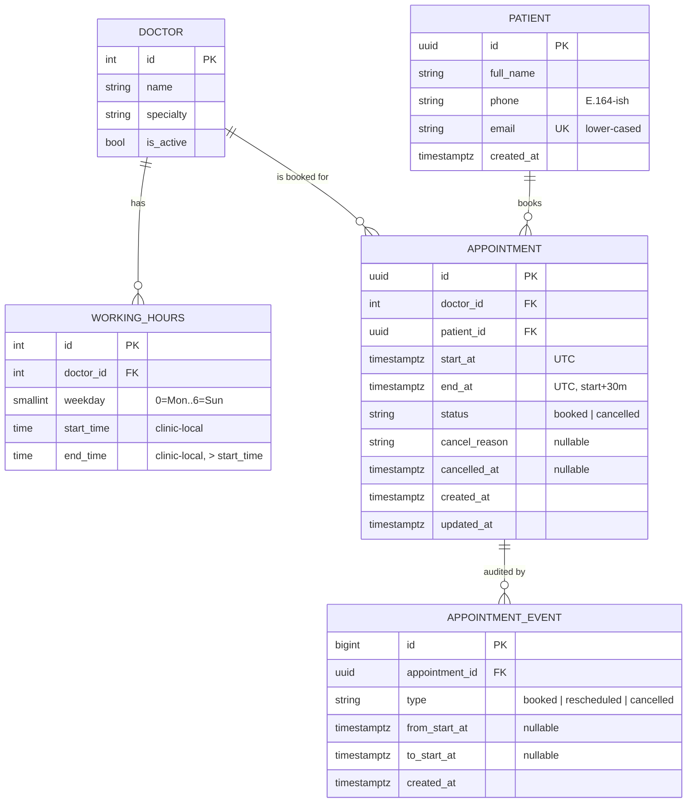

# Clinic Booking System

A REST API for a small clinic (5 doctors, 30-minute slots) where patients can see free slots, book, cancel, and reschedule appointments. It was built for the Savannah Informatics Implementation Engineer take-home.

- **Live URL:** `TODO(Caleb): https://<service>.onrender.com`. Not deployed yet; filled in after the Render service is created (see [Manual steps](#manual-steps)). No URL is invented here.
- **API docs:** `<live-url>/docs` (Swagger UI, with examples and documented error responses) and `<live-url>/redoc`. Locally: http://localhost:8000/docs
- **Deploys:** every PR merged into **`main`** → GitHub Actions re-runs CI → Render deploy hook → smoke test on the public URL ([§3](#3-deployment-and-cicd)).
- **Stack:** Python 3.12 · FastAPI · SQLAlchemy 2.0 · Alembic · Pydantic v2 · PostgreSQL 16 · uv · Docker · GitHub Actions · Render

> Section 1 (system design) was written and committed **before any application code** (first commit, `docs: system design`). Each later piece landed through its own PR, so the history shows CI running on PRs and deploy-on-merge.

**Contents:** [1. System design](#1-system-design) · [Assumptions & decisions](#assumptions--decisions) · [Running locally](#running-locally) · [2. API reference](#2-api-reference) · [3. Deployment and CI/CD](#3-deployment-and-cicd) · [Known limitations](#known-limitations) · [Manual steps](#manual-steps) · [4. AI reflection](#4-ai-reflection)

---

## 1. System design

### 1.1 Components

```
          HTTP
           │
┌──────────▼───────────┐   middleware: request-id · security headers · body-size limit
│  API layer (routers) │   CORS allowlist · rate limiting (write endpoints) · JSON access log
│  app/api/*           │   → parses/validates input (Pydantic), maps to service calls,
└──────────┬───────────┘     shapes responses. No business rules here.
           │
┌──────────▼───────────┐
│  Service layer       │   booking rules: slot grid, working hours, lead time, advance
│  app/services/*      │   window, cancel/reschedule state machine, availability calc.
└──────────┬───────────┘   Depends on a Clock (injected) and repositories.
           │
┌──────────▼───────────┐
│  Repository layer    │   SQLAlchemy queries only. Row locking (FOR UPDATE),
│  app/repositories/*  │   translating IntegrityError → domain errors.
└──────────┬───────────┘
           │
      PostgreSQL          source of truth for "a slot can be booked once"
                          (partial unique indexes)
```

Cross-cutting (`app/core/`):

| Piece | Responsibility |
|---|---|
| `config` | `pydantic-settings`. Everything comes from env vars (DB URL, clinic timezone, slot length, lead time, advance window, CORS origins, rate limits). There are no secrets in code. |
| `clock` | `Clock` protocol with `SystemClock` and `FixedClock`, injected as a FastAPI dependency. "Now" is controllable in tests without monkey-patching time. |
| `errors` | `AppError(code, message, http_status, details)` hierarchy, plus exception handlers that render **one error envelope** for domain errors, FastAPI/Pydantic validation errors, 404/405, rate limits and unexpected 500s. |
| `logging` | Structured JSON logs. Every line carries a `request_id`. IDs are logged, **never PII** (names, phones, emails, cancel reasons). |
| `db` | Engine and session factory (`pool_pre_ping`, bounded pool, statement timeout), declarative base, models. |
| Migrations | Alembic. The schema, including the partial unique indexes, lives in versioned migrations, never `create_all` in production. |
| Seed | `scripts/seed.py` is idempotent (upsert by natural key). It loads 5 doctors, their working hours and a demo patient, and is safe to re-run on every deploy. |

### 1.2 Data model



Notes:
- **WorkingHours** allows several windows per weekday (for example 08:00–12:00 and 13:00–17:00, so lunch is the gap). A weekday with no rows is a day off. A CHECK constraint enforces `end_time > start_time`.
- **IDs.** Patients and appointments use **random UUIDv4**. These IDs are exposed in URLs and the API has no auth (see 1.8), so sequential integers would let anyone enumerate `/appointments/1..N` and cancel other people's bookings (IDOR). UUIDs make guessing infeasible. Doctors use small ints because they are public catalogue data (there are 5 of them) and readable IDs help clients and reviewers.
- **Email** is normalised to lower case before it is stored, and it carries a unique index, so `Jane@X.com` and `jane@x.com` are the same patient.
- **appointment_events** is a minimal append-only audit trail (booked, rescheduled from→to, cancelled). It's cheap to write in the same transaction, and it keeps the history that an in-place reschedule would otherwise overwrite.

### 1.3 Key decision: slots are computed, not stored

There is **no `slots` table**. Availability for a doctor and date is:

```
candidate slots = for each working-hours window on that weekday:
                    walk from start_time in 30-min steps while step+30 <= end_time
                  (in clinic-local time, then convert to UTC)
available       = candidates − booked appointments that day − slots < now + lead time
```

This takes one query for the doctor's windows and one query for that doctor's booked appointments in the local day's UTC range. The difference is done in memory, about 16 slots per day, with no N+1.

| | Computed (chosen) | Pre-materialised slot rows |
|---|---|---|
| Changing working hours | Takes effect immediately | Needs regeneration and reconciliation with existing bookings |
| Background jobs | None | A cron must keep N days of future slots generated |
| Drift / stale data | Impossible | Possible (hours changed, cron failed) |
| Storage | O(appointments) | O(doctors × days × slots) |
| Per-slot locking / metadata | Via the unique index | `SELECT … FOR UPDATE` on the slot row; easy to attach per-slot notes or capacity |

**When I'd switch:** if slots gain their own lifecycle or metadata, such as per-slot capacity (group sessions), manual blocking of individual slots by staff, overbooking policies, or very heavy availability reads where precomputation and caching pay off.

### 1.4 Key decision: the database prevents double booking

An application-level "check if free, then insert" **races**. Two requests can both see the slot free and both insert. Correctness is enforced by Postgres:

```sql
CREATE UNIQUE INDEX uq_appointments_doctor_slot
    ON appointments (doctor_id, start_at) WHERE status = 'booked';
CREATE UNIQUE INDEX uq_appointments_patient_slot
    ON appointments (patient_id, start_at) WHERE status = 'booked';
```

- The service still pre-checks, but only to return friendlier errors. The **insert/update is the real check**. A unique violation is caught, mapped by constraint name, and returned as **409 `SLOT_TAKEN`** (or `PATIENT_DOUBLE_BOOKED` for the patient index, which stops one patient holding two doctors at the same time).
- **Cancelling** flips `status` to `cancelled`. The row falls out of the partial index, so the slot is free again with no extra bookkeeping, and history is kept (no deletes).
- The doctor index also serves the availability query (`doctor_id = ? AND start_at in range AND status='booked'`). This is verified with `EXPLAIN` (see [Query plans](#query-plans-explain)).
- **Growth path:** this relies on every appointment being exactly one slot long and grid-aligned, so "overlap" means "same start". If variable durations arrive (15/45/60 min), switch to an exclusion constraint:
  `EXCLUDE USING gist (doctor_id WITH =, tstzrange(start_at, end_at) WITH &&) WHERE (status='booked')` (needs `btree_gist`). That's more general, but slower to write and harder to explain, so it isn't justified today.

### 1.5 Time zones

- Everything is **stored in UTC** (`timestamptz`). Working hours are **clinic-local wall-clock times**, interpreted in `CLINIC_TIMEZONE` (default `Africa/Nairobi`, via `zoneinfo`).
- The API accepts and returns ISO-8601 **with an offset**. **Naive datetimes are rejected (422)**, because guessing the time zone of a medical appointment is not acceptable. Responses are rendered in clinic time (`2026-11-02T09:00:00+03:00`).
- Slot generation and grid checks happen **in local time first, then convert**. Nairobi has no DST today, but doing it this way means the code stays correct if the clinic (or a future second clinic) is in a DST zone. A "day" means the clinic-local day, and its UTC bounds are computed with `zoneinfo`.

### 1.6 Booking rules (shared by book and reschedule)

Validation runs in this order, and the first failure wins, with a stable error code:

1. Doctor exists and is active, else `404 DOCTOR_NOT_FOUND`. Patient exists, else `404 PATIENT_NOT_FOUND`.
2. `start_at` is timezone-aware, else `422` (validation).
3. Aligned to the 30-minute grid in clinic-local time (minute ∈ {0, 30}, seconds = 0), else `422 NOT_ON_SLOT_GRID`.
4. Not in the past, else `422 SLOT_IN_PAST`. Not within `MIN_LEAD_TIME_MINUTES` (default 60) of now, else `422 TOO_SOON`.
5. Not beyond `MAX_ADVANCE_DAYS` (default 90), else `422 TOO_FAR_IN_ADVANCE`.
6. `[start, start+30m)` fits entirely inside one working-hours window that weekday, else `422 OUTSIDE_WORKING_HOURS` (this covers days off, lunch gaps and slots straddling the window end).
7. Insert or update. A unique violation returns `409 SLOT_TAKEN` or `409 PATIENT_DOUBLE_BOOKED`.

**Cancel** (`PATCH /appointments/{id}/cancel`, body `{reason}`, 3–500 chars after trimming): the row is locked with `SELECT … FOR UPDATE`. Already cancelled returns `409 ALREADY_CANCELLED`. Already started (`start_at <= now`) returns `409 APPOINTMENT_STARTED`, since cancelling a past visit is a records problem, not a booking action.

**Reschedule** (`PATCH /appointments/{id}/reschedule`, body `{start_at}`): in one transaction, lock the row. Cancelled returns `409 APPOINTMENT_CANCELLED`. Started returns `409 APPOINTMENT_STARTED`. Same start returns `422 NO_CHANGE`. Then it runs the **same** validation as a fresh booking and `UPDATE`s `start_at/end_at` on the same row. The old slot is freed by that same UPDATE. If the new slot is taken, the unique index fails the UPDATE, the transaction rolls back, and **the original appointment is untouched**. It keeps the same doctor (see decisions table).

Row locks plus DB uniqueness mean concurrent cancel/reschedule/book on the same appointment or slot serialise correctly. Exactly one concurrent booking of a slot wins.

### 1.7 API surface

| Method & path | Purpose | Success |
|---|---|---|
| `POST /appointments` | Book a slot | 201 |
| `GET /appointments/{id}` | Fetch one appointment *(addition)* | 200 |
| `PATCH /appointments/{id}/cancel` | Cancel with a reason | 200 |
| `PATCH /appointments/{id}/reschedule` | Move to a new slot (same doctor) | 200 |
| `GET /doctors` | List active doctors *(addition)* | 200 |
| `GET /doctors/{id}/availability?date=YYYY-MM-DD` | Free 30-min slots that day | 200 |
| `POST /patients` | Register a patient *(addition, bookings need a patient)* | 201 |
| `GET /patients/{id}/appointments?limit&offset` | Upcoming booked appointments, ascending *(bonus)* | 200 |
| `GET /health` | Liveness, no DB, not rate limited | 200 |
| `GET /ready` | Readiness, checks DB with `SELECT 1` | 200 / 503 |

Error envelope (every error, including framework validation errors):

```json
{"error": {"code": "SLOT_TAKEN", "message": "That slot has just been booked. Pick another.", "details": {"doctor_id": 1, "start_at": "..."}, "request_id": "..."}}
```

Status codes: 201 created · 200 OK · 404 unknown resource · 409 state conflict (taken / already cancelled / cancelled reschedule / started) · 422 validation and business-rule violations on the input · 429 rate limited · 503 not ready · 500 generic message only (the stack trace goes to logs).

> Why 422 and not 400 for rule violations: FastAPI already uses 422 for schema errors. Using it for "well-formed but not acceptable" input (past, off-grid, outside hours) keeps one rule for clients: **4xx-422 means fix your input, 409 means the world changed, retry with a different slot.**

### 1.8 Security and auth trade-off

The spec defines **no authentication**. The real consequence is that **anyone who has an appointment's ID can view, cancel or reschedule it**, and anyone can list a patient's appointments if they know the patient's ID. What I did instead of ignoring it:

- **Non-enumerable UUIDv4** IDs for patients and appointments, so there's no ID guessing.
- **Rate limiting** on write endpoints (per client IP) to blunt brute-force and abuse. It uses an in-memory store, which is fine for one instance. **Multiple instances need a shared store (Redis)**.
- Strict input validation (extra fields forbidden, length limits, email/phone formats), ORM-only queries, CORS allowlist, security headers, body-size limit, no PII in logs, and generic 500s.
- **Planned real auth (first growth item):** patient login by phone OTP (fits Kenya, where SMS is ubiquitous) issuing short-lived JWTs, with every appointment endpoint scoped to `patient_id == token.sub`. Staff roles (reception/doctor/admin) would use separate scopes for managing other people's appointments.

### 1.9 Growth path (prioritised)

1. **Auth** (patient OTP + JWT, staff RBAC), as above. This is the biggest current risk.
2. **Doctor time off / clinic holidays** table, subtracted in the availability calculation (no schema change elsewhere).
3. **Notifications** (confirmation, reminder 24h before) via an outbox table and a worker/queue. Use SMS and WhatsApp first for Kenya. M-Pesa deposit for no-show reduction is an adjacent flow.
4. **Multi-clinic / tenancy**: a `clinic_id` on doctors (each clinic with its own time zone, which the local-time-first design already supports), and scoping on every query.
5. **Variable durations / appointment types**: move to the `tstzrange` exclusion constraint (1.4).
6. **Scale**: pagination is already in place for patient lists. Next would be a short-TTL availability cache invalidated on writes, a read replica for availability, a shared Redis rate limiter, and edge rate limiting/WAF.
7. **Observability**: request IDs and JSON logs already exist. Add metrics (booking success/409 rate, latency) and tracing (OpenTelemetry), with alerts on `/ready`.

---

## Assumptions & decisions

| # | Decision | Alternatives considered | Why |
|---|---|---|---|
| 1 | Slots computed from working hours, not stored | Materialised slot rows | No cron, no drift, hours changes are immediate (see 1.3) |
| 2 | DB partial unique indexes prevent double booking | App-level check-then-insert; advisory locks; `tstzrange` exclusion | Race-free with no extra moving parts. Exclusion constraint is the growth path |
| 3 | Patient can't hold two appointments at the same instant | Allow it | Physically impossible, and almost always a mistake or abuse |
| 4 | UUIDv4 for patients/appointments, int for doctors | All ints; ULIDs | Mitigates IDOR without auth. Doctors are public catalogue data |
| 5 | Reject naive datetimes (422) | Assume clinic TZ; assume UTC | Silent assumptions about appointment time are dangerous |
| 6 | Responses rendered in clinic time zone with offset | Return UTC `Z` | Clients show clinic-local times; the offset keeps it unambiguous |
| 7 | Availability for a past date returns 200 with `[]` | 422 | It's a valid question with an empty answer, and it's simpler for UIs |
| 8 | Availability beyond `MAX_ADVANCE_DAYS` returns 200 with `[]` | 422 | Consistent with 7; booking itself is rejected with `TOO_FAR_IN_ADVANCE` |
| 9 | Rule violations return 422 with a specific code; state conflicts return 409 | 400 for rule violations | One convention for clients (see 1.7) |
| 10 | Cancelling or rescheduling an already-started appointment returns 409 `APPOINTMENT_STARTED` | Allow it | Past visits are clinical records, not bookings |
| 11 | Reschedule updates the same row, same doctor only | New row + cancel old; allow doctor change | Keeps identity/history and is atomic. A doctor change is a new booking (cancel + book), which is clearer for patients and audits |
| 12 | Reschedule to the identical slot returns 422 `NO_CHANGE` | 200 no-op | Spec-directed; surfaces client bugs |
| 13 | `POST /patients` added (email unique; duplicate returns 409 `PATIENT_EXISTS`) | Inline patient in booking body | Booking requires a patient ID. Keeps patient identity explicit |
| 14 | Sync SQLAlchemy + psycopg 3 (FastAPI threadpool) | Async SQLAlchemy | Workload is tiny and DB-bound. Sync is simpler to reason about and test with real threads |
| 15 | Postgres everywhere, including tests | SQLite for tests | Partial unique indexes, `FOR UPDATE` and real concurrency semantics must be what's tested |
| 16 | Minimal `appointment_events` audit table | None (growth item) | Cheap (same transaction), and preserves reschedule history |
| 17 | No availability cache | TTL cache | 2 indexed queries per request at this scale. A cache adds invalidation bugs for no measurable gain |
| 18 | **Keep-alive pinger**: a scheduled GitHub Action hits `/health` every 10 min. **Decision: Caleb** (made without AI) | Paid always-on instance; accept cold starts; external uptime monitor | Trade-offs in [Keep-alive](#keep-alive-free-tier-cold-starts). Why I trusted my own judgment: `TODO(Caleb)` |
| 19 | Small in-process rate limiter (sliding window, per IP, DI-injected) instead of `slowapi` | `slowapi`; edge/WAF only | `slowapi` binds limits at import time through a global decorator and needs a `request` param on every endpoint, which makes per-test config awkward. The same in-memory caveat applies either way |
| 20 | No `SELECT` "is it free?" pre-check before insert | Pre-check for a friendlier error | The unique-violation path already returns the same friendly 409, and a pre-check would add a query and a false sense of safety |
| 21 | No separate plain `(patient_id, start_at)` index | Add it as the brief suggested | `uq_appointments_patient_slot` (partial, same columns) already serves the upcoming-appointments query. Verified with EXPLAIN below. A second index would only cost writes |
| 22 | Migrations + idempotent seed run in the container start script | Render pre-deploy command; manual migration step | Render's free tier has no pre-deploy command. Safe for one instance (Alembic DDL is transactional). With more instances, move it to a pre-deploy/release job |
| 23 | Smoke test waits until `/health` reports the merged commit | Hit `/health` right after the hook | The hook returns immediately while the *old* release keeps serving, so a naive check would pass against the wrong version |
| 24 | Render `autoDeploy: false`; GitHub Actions triggers the deploy after CI passes | Render auto-deploy on push | One gate: nothing deploys unless the merge result passes the same CI |
| 25 | Duplicate email returns 409 `PATIENT_EXISTS` | Return the existing patient; silent 201 | Returning the existing record would leak its ID to anyone who knows an email. A 409 still reveals that the email is registered (accepted for now, rate limited). Real fix: OTP login (§1.8) |
| 26 | Times returned in clinic time (`+03:00`), including `created_at` on patients | Mixed UTC/local | One rule for clients. Found during manual testing, when `POST /patients` returned `…Z` |
| 27 | Region Frankfurt | Oregon, Ohio, Singapore | Lowest latency to Nairobi among Render regions |
| 28 | Local compose Postgres on host port **55432** | 5432/5433 | Avoids clashing with locally installed Postgres (this dev machine already had one on 5433) |

---

## Running locally

### With Docker (one command)

```bash
docker compose up --build
# API on http://localhost:8000 (docs at /docs). Migrations and seed run on boot.
```

This was verified from a fresh `git clone`. The API container runs as `uid=999(app)` with a read-only root filesystem.

### Without Docker (uv)

```bash
pip install uv            # or see https://docs.astral.sh/uv/
uv sync --frozen          # all deps incl. dev, exactly as locked
cp .env.example .env
docker compose up -d db   # or point DATABASE_URL at any Postgres 14+
make migrate seed run     # alembic upgrade head · seed · uvicorn --reload
```

### Quality gates

```bash
make test     # pytest against real Postgres (creates/drops the clinic_test DB)
make cov      # with coverage
make lint     # ruff check + ruff format --check + mypy --strict + bandit
make audit    # pip-audit on the locked runtime dependencies
```

Tests use `TEST_DATABASE_URL` (default `…localhost:55432/clinic_test`). The suite drops and recreates that database, runs the Alembic migrations, and truncates and re-seeds before each test. It truncates rather than rolling back because the concurrency tests need committed data visible across threads.

Latest local run: **121 passed**, 98% line+branch coverage. `app/services` and `app/repositories` are at 100%, except one defensive re-raise in `repositories/integrity.py`.

---

## 2. API reference

Full interactive docs live at `/docs`. The flow below is **real output** from the Docker stack (next Monday was 2026-10-26; IDs shortened).

```bash
B=http://localhost:8000

# Register a patient (email lower-cased, Kenyan local phone normalised to E.164)
curl -s -X POST $B/patients -H 'Content-Type: application/json' \
  -d '{"full_name":"Wanjiku Njoroge","phone":"0712 345 678","email":"Wanjiku@Example.com"}'
# 201 {"id":"816df067-…","full_name":"Wanjiku Njoroge","phone":"+254712345678","email":"wanjiku@example.com",…}

# Free slots (doctor 1 works 08:00–12:00 and 13:00–17:00, so 16 slots)
curl -s "$B/doctors/1/availability?date=2026-10-26"
# 200 {"doctor_id":1,"date":"2026-10-26","timezone":"Africa/Nairobi","slot_minutes":30,
#      "slots":[{"start":"2026-10-26T08:00:00+03:00","end":"2026-10-26T08:30:00+03:00"}, …]}

# Book
curl -s -X POST $B/appointments -H 'Content-Type: application/json' \
  -d '{"doctor_id":1,"patient_id":"816df067-…","start_at":"2026-10-26T09:00:00+03:00"}'
# 201 {"id":"4d275138-…","start_at":"2026-10-26T09:00:00+03:00","end_at":"2026-10-26T09:30:00+03:00","status":"booked",…}

# Same slot again (any patient)
# 409 {"error":{"code":"SLOT_TAKEN","message":"That slot has just been booked. Please pick another.","details":{},"request_id":"ef16…"}}

# Off the grid
# 422 {"error":{"code":"NOT_ON_SLOT_GRID","message":"Appointments start on 30-minute boundaries in Africa/Nairobi time (e.g. 09:00 or 09:30), with zero seconds.", …}}

# Naive datetime ("2026-10-26T09:00:00")
# 422 {"error":{"code":"VALIDATION_ERROR","message":"Request validation failed.",
#      "details":{"errors":[{"loc":["body","start_at"],"msg":"Input should have timezone info","type":"timezone_aware"}]}, …}}

# Reschedule (same doctor, same appointment id; old slot freed atomically)
curl -s -X PATCH $B/appointments/4d275138-…/reschedule -H 'Content-Type: application/json' \
  -d '{"start_at":"2026-10-26T14:30:00+03:00"}'
# 200 {"id":"4d275138-…","start_at":"2026-10-26T14:30:00+03:00",…,"status":"booked"}

# Upcoming for the patient (booked, start >= now, soonest first, paginated)
curl -s "$B/patients/816df067-…/appointments?limit=20&offset=0"
# 200 {"patient_id":"816df067-…","total":1,"limit":20,"offset":0,"items":[{…"start_at":"2026-10-26T14:30:00+03:00"…}]}

# Cancel, then cancel again
curl -s -X PATCH $B/appointments/4d275138-…/cancel -H 'Content-Type: application/json' \
  -d '{"reason":"Travelling that week"}'
# 200 {…,"status":"cancelled","cancel_reason":"Travelling that week","cancelled_at":"2026-10-23T11:51:22.949642+03:00"}
# 409 {"error":{"code":"ALREADY_CANCELLED","message":"This appointment is already cancelled.",…}}
```

Every response carries `X-Request-ID` (an incoming one is echoed if it is safe), plus `X-Content-Type-Options: nosniff`, `Referrer-Policy: no-referrer`, `X-Frame-Options: DENY`, and on JSON `Content-Security-Policy: default-src 'none'` and `Cache-Control: no-store`. HSTS is added in production.

### Error codes

| HTTP | `code` | When |
|---|---|---|
| 404 | `DOCTOR_NOT_FOUND` | Unknown **or inactive** doctor |
| 404 | `PATIENT_NOT_FOUND` | Unknown patient (booking, upcoming list) |
| 404 | `APPOINTMENT_NOT_FOUND` | Unknown appointment id |
| 404 / 405 | `NOT_FOUND` / `METHOD_NOT_ALLOWED` | Unknown route / wrong method |
| 409 | `SLOT_TAKEN` | Doctor already booked at that time (from the DB unique index) |
| 409 | `PATIENT_DOUBLE_BOOKED` | Patient already has an appointment at that time (any doctor) |
| 409 | `ALREADY_CANCELLED` | Cancelling a cancelled appointment |
| 409 | `APPOINTMENT_CANCELLED` | Rescheduling a cancelled appointment |
| 409 | `APPOINTMENT_STARTED` | Cancelling/rescheduling an appointment whose start time has passed |
| 409 | `PATIENT_EXISTS` | Registering an email that exists (case-insensitive) |
| 413 | `PAYLOAD_TOO_LARGE` | Body over `MAX_BODY_BYTES` (16 KiB) |
| 422 | `VALIDATION_ERROR` | Schema errors: naive/invalid datetime, bad date, unknown fields, bad UUID, reason length, email/phone format, pagination bounds |
| 422 | `NOT_ON_SLOT_GRID` | Start not on a 30-minute boundary in clinic time (or has seconds) |
| 422 | `SLOT_IN_PAST` | Start is now or earlier |
| 422 | `TOO_SOON` | Start within `MIN_LEAD_TIME_MINUTES` (60) of now (bonus rule) |
| 422 | `TOO_FAR_IN_ADVANCE` | Start beyond `MAX_ADVANCE_DAYS` (90) |
| 422 | `OUTSIDE_WORKING_HOURS` | Not entirely inside one working window. Covers days off, lunch gaps, and slots straddling a window end. `details.working_hours` lists that day's windows |
| 422 | `NO_CHANGE` | Rescheduling to the same instant |
| 429 | `RATE_LIMITED` | Write endpoints over `RATE_LIMIT_WRITES` (30/min per IP); `Retry-After` header |
| 500 | `INTERNAL_ERROR` | Generic message only; the traceback goes to logs with the same `request_id` |
| 503 | `NOT_READY` | `/ready` cannot reach the database |

### What the tests cover

All of these run against a real Postgres. Files are in `tests/`.

- **Booking** (`test_booking.py`): success and UTC storage (09:00 Nairobi is stored as `06:00Z` and returned as `+03:00`), the same instant given as `Z`, before/after hours, lunch gap, day off, off-grid (minutes, seconds, off-grid given in UTC), past, starting-now, lead-time boundary (exactly 60 min allowed), advance window, unknown/inactive doctor, unknown patient, naive/invalid/extra-field payloads, last slot of a window, straddling a non-grid window end, `:30` windows, sequential double booking, patient in two places.
- **Concurrency** (`test_concurrency.py`): 10 threads booking one slot give exactly 1 success and 9 `SLOT_TAKEN`. Reschedule vs booking of the same target gives exactly one winner over 5 rounds, and if the booking wins the original appointment is untouched. Two simultaneous cancels give one success and one `ALREADY_CANCELLED`. **Mutation check:** with `uq_appointments_doctor_slot` dropped, the same 10-thread race produced 10 successes. So the index is what prevents double booking, and the test would catch its removal.
- **Availability**: exact slot lists, lunch break, booked hidden, cancelled reappears, past/too-soon hidden, day off, past date and beyond-horizon empty, windows not aligned to the grid, invalid date 422, unknown doctor 404.
- **Cancel / reschedule**: frees and rebooks; 409s; reason trimming and 3–500 bounds; same-slot `NO_CHANGE`; every booking rule re-applied; taken target leaves the original booked; audit events.
- **Patients**: normalisation, case-insensitive duplicates, upcoming-only, sorted, cancelled excluded, pagination and bounds.
- **Platform**: envelope shape for 404/405/422/malformed JSON/413/500, request-id echo, security headers, rate limiting (429 + `Retry-After`; reads not limited), `/ready` 503, OpenAPI documents the envelope, settings validation.
- **Slots (pure)**: UTC conversion, local day bounds, **DST**: Europe/London spring-forward skips nonexistent 01:00/01:30, and the day is 23h. Grid checked in local time for a `+05:30` zone.
- **Scripts**: keep-alive retries/backoff/exit codes/`/ready` cadence (HTTP mocked); smoke test waits for the new version.

### Query plans (EXPLAIN)

Run on the compose database after loading **~100k synthetic appointments** (5 doctors × 16 slots × ~1,250 days, 10% cancelled, 2,000 patients). With a handful of rows Postgres would just seq-scan, which proves nothing.

| Query (as issued by the app) | Plan | Time |
|---|---|---|
| Availability: booked starts for doctor 1 on one local day | **Index Only Scan using `uq_appointments_doctor_slot`** (`doctor_id = 1 AND start_at >= … AND start_at < …`), 16 rows | 0.27 ms |
| Patient upcoming, page (`LIMIT 20`) | **Index Scan using `uq_appointments_patient_slot`** | 0.25 ms |
| Patient upcoming, total count | **Bitmap Index Scan on `uq_appointments_patient_slot`** | 0.32 ms |
| Working hours for doctor + weekday | Seq Scan (41 rows; the planner rightly ignores `ix_working_hours_doctor_weekday` at this size) | n/a |

The first patient-page plan showed an `Incremental Sort` caused by an `ORDER BY start_at, id` tie-breaker. `start_at` is already unique per patient among booked rows, so the tie-breaker was dropped and the index supplies the order. The partial indexes match because the app filters on `status = 'booked'` exactly as the index predicate does.

**Why no availability cache:** two indexed sub-millisecond queries per request at this scale. A cache would add an invalidation path on every book/cancel/reschedule (a classic source of "slot shows free but booking fails" bugs) for no measurable gain. Revisit with read replicas or heavy traffic (growth path §1.9).

---

## 3. Deployment and CI/CD

| Workflow | Trigger | What it does |
|---|---|---|
| **CI** (`.github/workflows/ci.yml`) | every `pull_request` (and reused by Deploy) | **lint**: `ruff check`, `ruff format --check`, `mypy --strict`, `bandit`, `pip-audit --strict` on the locked runtime deps · **secrets**: gitleaks over full history · **tests**: Postgres 16 service, `alembic upgrade → downgrade base → upgrade`, `alembic check` (models ↔ migrations), `pytest --cov` (coverage XML uploaded) · **docker**: image builds. Any failure fails the PR. |
| **Deploy** (`deploy.yml`) | `push` to **`main`**, i.e. when a PR is merged | Re-runs the whole CI on the merge result, then `POST`s the Render deploy hook, then `scripts/smoke.py` polls `<APP_URL>/health` until it reports **this commit** (Render's `RENDER_GIT_COMMIT`), then requires `/ready` 200 and a non-empty `/doctors`. A failed smoke test fails the workflow. `concurrency: deploy-production` (no overlapping deploys, never cancelled mid-way). It skips with a warning until the secret and variable exist (this is what the first run on `main` did). |
| **Keep-alive** (`keepalive.yml`) | cron `*/10 * * * *` + manual | Pings `/health` from outside Render; see below. |

All workflows use `permissions: contents: read`. Actions are pinned to full commit SHAs, and secrets come only from GitHub secrets. Dependabot (`.github/dependabot.yml`) watches uv, Actions and Docker.

**Hosting:** Render Blueprint (`render.yaml`): Docker web service + managed Postgres 16, both free tier in Frankfurt. The container (`Dockerfile`) is multi-stage: deps are installed from `uv.lock` in a build stage, the runtime is `python:3.12-slim` with no uv and no dev deps, it runs as a non-root `app` user, and it has a `HEALTHCHECK` on `/health`. `scripts/start.sh` runs `alembic upgrade head` and the idempotent seed before `uvicorn` (decision 22). The DB connection has `pool_pre_ping`, a small pool sized for the free DB, `statement_timeout=5s` and `lock_timeout=3s`.

**Branch protection on `main` (configured via `gh api`):** a PR is required, with the four status checks passing and up to date (`Lint, types, security scan`, `Secret scan`, `Tests (Postgres)`, `Docker image builds`). Force pushes and deletion are blocked. Approvals are set to 0 because this is a one-person repo. Admins are not enforced, which leaves an emergency escape hatch; switch on "Do not allow bypassing" for a team.

### Keep-alive (free-tier cold starts)

**Decision: Caleb** (Caleb's idea, made without AI): Render's free web services spin down after ~15 minutes without inbound traffic, and a cold start can take up to a minute. `scripts/keepalive.py` (standard library only) is run by `.github/workflows/keepalive.yml` every 10 minutes:

- `GET <APP_URL>/health` with a 75 s timeout (survives a cold start), up to 3 attempts with 5 s / 15 s backoff, and one log line per attempt with status and latency. Every 3rd run (by `GITHUB_RUN_NUMBER`) it also hits `/ready` to keep a DB connection warm.
- `APP_URL` is a **repository variable** (not a secret, not hardcoded). If it is unset, the script logs a notice and exits 0, so it is harmless before the first deploy. If every attempt fails, it exits 1 so the failure shows in Actions.
- The ping comes from **outside** Render (a sleeping service cannot wake itself). `/health` does no DB call, is unauthenticated, is not rate limited, and is logged at DEBUG only, so pings neither pollute logs nor trip limits.

Trade-offs, stated honestly:

- (a) GitHub scheduled workflows are **best-effort**. They can be delayed or skipped under load, so this **reduces** cold starts but does not guarantee zero.
- (b) GitHub **disables scheduled workflows after 60 days without repository activity**.
- (c) ~4,300 runs/month, each billed at least 1 minute: **free on a public repo** (this one is public), but it would exceed the free minutes of a private repo. Keep the repo public, or use an external pinger.
- (d) One always-on free instance fits within Render's monthly free instance hours (~744 h needed out of the free allowance). This does **not** stop the **free Postgres from expiring** after Render's time limit (30 days at the time of writing; check the dashboard). `TODO(Caleb)`: note the expiry date before submission.
- (e) This is a demo-grade workaround. The production answer is a paid always-on instance, or accepting cold starts behind a status page.
- (f) Optional second layer (manual): an external uptime monitor (UptimeRobot or cron-job.org) on `<APP_URL>/health`.

---

## Known limitations

- **No authentication** (the spec defines none). Anyone holding an appointment UUID can view, cancel or reschedule it (§1.8 has the mitigations and the plan).
- Rate limiting is **per process, in memory**. Multiple instances need Redis or edge limiting. Behind Render, client IPs come from `X-Forwarded-For` (`FORWARDED_ALLOW_IPS="*"`, safe only because Render's proxy is the sole ingress).
- Free tier: cold starts (mitigated by keep-alive), the free Postgres expires, and there are no backups.
- Doctors' holidays/time off, variable durations, and notifications are not implemented (growth path §1.9).
- `POST /patients` reveals whether an email is registered (decision 25).
- The Render side (deploy hook, `RENDER_GIT_COMMIT`, the blueprint) is **not verified** yet, because no Render account was available to this session.

---

## Manual steps

Things that need Caleb's accounts, so they were not faked:

1. **Render:** sign in at https://dashboard.render.com, choose **New → Blueprint**, and connect `MundatiC/clinic-booking-system` (branch `main`). It reads `render.yaml` and creates `clinic-booking-api` and `clinic-db`. When prompted for `CORS_ORIGINS`, enter the service URL (e.g. `https://clinic-booking-api.onrender.com`; it can be fixed after step 2).
2. Wait for the first deploy, then copy the public URL from the service page. Check that `curl https://<url>/health` returns `{"status":"ok","version":"<commit sha>"}`. If `version` is `dev`, Render did not inject `RENDER_GIT_COMMIT`. Add an env var `GIT_COMMIT` manually or tell me, and I'll adjust the smoke test.
3. Service → **Settings → Deploy Hook**: copy the URL.
4. GitHub secret and variable:
   ```bash
   gh secret set RENDER_DEPLOY_HOOK_URL --repo MundatiC/clinic-booking-system   # paste the hook URL
   gh variable set APP_URL --repo MundatiC/clinic-booking-system --body "https://<your-service>.onrender.com"
   ```
5. Trigger a deploy through the pipeline and watch the smoke test: `gh workflow run deploy.yml --repo MundatiC/clinic-booking-system`, then `gh run watch`.
6. Start the keep-alive once by hand: `gh workflow run keepalive.yml --repo MundatiC/clinic-booking-system`.
7. Update the **Live URL** line at the top of this README (replace the `TODO(Caleb)`), and the docs link.
8. Note the free Postgres expiry date from the Render dashboard (keep-alive trade-off d).
9. Optional: an UptimeRobot / cron-job.org monitor on `https://<url>/health`.
10. Branch protection is **already configured** (see §3). Optionally require approvals or enforce it for admins under Settings → Branches → `main`.

---

## 4. AI reflection

> Written only from what is recorded in [`AI_LOG.md`](AI_LOG.md) for this project. AI tool: Claude Code (Claude Opus 5.5), working in the terminal from one detailed brief written by Caleb.

**1. What AI was used for, by section**

- **Section 1 (design):** Caleb's brief already fixed the main decisions: computed slots, partial unique indexes, UUIDs, UTC storage with Nairobi-local hours, row locks, Render, and Postgres-only tests. The AI wrote the design document around them, drew the ER diagram, and proposed the secondary rules: 422 vs 409, `APPOINTMENT_STARTED`, `PATIENT_EXISTS`, empty availability beyond the horizon, and sync SQLAlchemy.
- **Section 2 (API):** the AI wrote all application code and the 121 tests, ran them against Postgres, and fixed what they exposed.
- **Section 3 (deployment):** the AI wrote the Dockerfile, compose, CI/deploy/keep-alive workflows, the smoke and keep-alive scripts and `render.yaml`. It resolved action versions to commit SHAs via the GitHub API, verified `docker compose up` from a fresh clone, and ran EXPLAIN on a loaded database. Creating the Render service and secrets could not be done by AI.
- **Section 4:** the AI kept `AI_LOG.md` during the work and drafted this reflection from it. The parts that need Caleb's own reasoning are left as `TODO(Caleb)`.

**2. An AI suggestion that improved the work**

The brief asked for "a post-deploy smoke test hitting `/health` and `/ready` on the public URL, failing the workflow if unhealthy". While writing it, the AI pointed out that a Render deploy hook returns immediately while the old release keeps serving. So a smoke test that simply hits `/health` would pass against the old version and give false confidence on a broken deploy. It proposed exposing the deployed commit in `/health` (from Render's `RENDER_GIT_COMMIT`) and having `scripts/smoke.py` wait until the live version equals the merged `GITHUB_SHA` before checking `/ready` and `/doctors` (decision 23).

A second, smaller one: the AI proposed proving the concurrency test is meaningful. With the unique index dropped, 10 racing threads all succeeded (`Counter({'ok': 10})`); with it, exactly one did.

**3. AI output that was wrong or incomplete, and how it was caught**

- **Caught by the AI's own tests:** the first version rendered unexpected 500s through a FastAPI `Exception` handler. Starlette runs that handler in `ServerErrorMiddleware`, outside the app's middleware, so the 500 body had `request_id: null` and no security headers. `test_unhandled_error_is_generic_500` failed on the envelope shape, and the fix moved 500 rendering into the request-context middleware. In the same run, a test's cleanup exposed a missing ORM cascade on `Appointment.events` (a NOT NULL violation on delete).
- **Caught by reading framework source:** the first body-size limit raised a custom error that FastAPI would have silently converted into a generic 400. Checking `fastapi/routing.py` showed only `HTTPException` is re-raised.
- **Caught by Caleb:** the AI's default was to add a `Co-Authored-By: Claude` trailer to commits. Caleb stopped the session and set a rule against it, and the already-pushed first commit was rewritten.
- **A weak test, caught on re-read:** the AI wrote one parametrized test asserting `code in {code, "TOO_SOON", "OUTSIDE_WORKING_HOURS"}`, which could pass for the wrong reason. It was tightened to an exact match before it was ever relied on.

**4. Two decisions made without AI**

- **Keep-alive pinger** (decision 18, Decision: Caleb). Why I trusted my own judgment here: `TODO(Caleb)`: in your own words.
- **Second decision:** `TODO(Caleb)`: pick one that was genuinely yours before the session and explain it in your own words. Candidates that appear in your brief, so the AI did not originate them (only you know whether you decided them unaided): using real Postgres instead of SQLite for tests; enforcing double-booking prevention in the database rather than in application code; non-enumerable UUIDs for patients and appointments; computing slots instead of storing them; Render + GitHub Actions as the platform.
