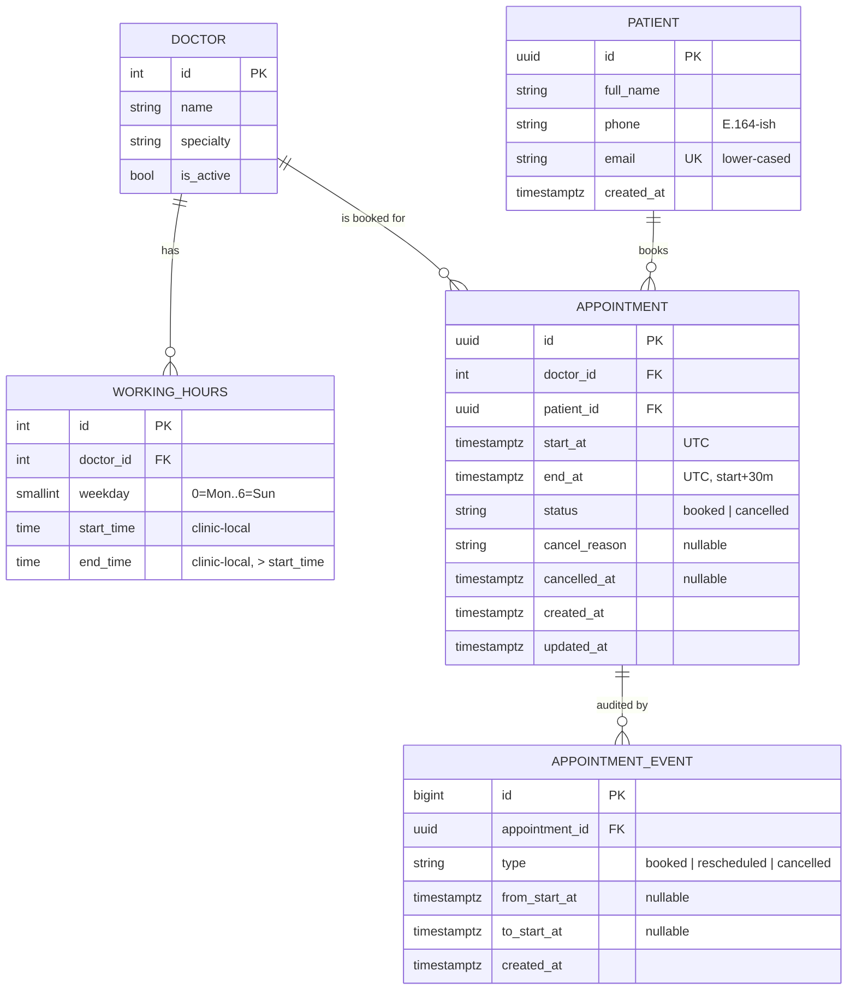

# Clinic Booking System

A REST API for a small clinic (5 doctors, 30-minute slots) where patients can see free slots, book, cancel, and reschedule appointments. It was built for the Savannah Informatics Implementation Engineer take-home.

- **Live URL:** _not deployed yet. This will be filled in once the Render service exists (I will not invent a URL)._
- **API docs:** `{LIVE_URL}/docs` (Swagger UI) and `{LIVE_URL}/redoc`
- **Stack:** Python 3.12 · FastAPI · SQLAlchemy 2.0 · Alembic · Pydantic v2 · PostgreSQL 16 · uv · Docker · GitHub Actions · Render

> Section 1 (system design) was written and committed **before any application code** (see the first commit, `docs: system design`). Later sections are filled in as the work lands.

---

## 1. System design

### 1.1 Components

```
          HTTP
           │
┌──────────▼───────────┐   middleware: request-id · security headers · body-size limit
│  API layer (routers) │   CORS allowlist · rate limiting (write endpoints) · JSON access log
│  app/api/*           │   → parses/validates input (Pydantic), maps to service calls,
└──────────┬───────────┘     shapes responses. No business rules here.
           │
┌──────────▼───────────┐
│  Service layer       │   booking rules: slot grid, working hours, lead time, advance
│  app/services/*      │   window, cancel/reschedule state machine, availability calc.
└──────────┬───────────┘   Depends on a Clock (injected) and repositories.
           │
┌──────────▼───────────┐
│  Repository layer    │   SQLAlchemy queries only. Row locking (FOR UPDATE),
│  app/repositories/*  │   translating IntegrityError → domain errors.
└──────────┬───────────┘
           │
      PostgreSQL          source of truth for "a slot can be booked once"
                          (partial unique indexes)
```

Cross-cutting (`app/core/`):

| Piece | Responsibility |
|---|---|
| `config` | `pydantic-settings`. Everything comes from env vars (DB URL, clinic timezone, slot length, lead time, advance window, CORS origins, rate limits). There are no secrets in code. |
| `clock` | `Clock` protocol with `SystemClock` and `FixedClock`, injected as a FastAPI dependency. "Now" is controllable in tests without monkey-patching time. |
| `errors` | `AppError(code, message, http_status, details)` hierarchy, plus exception handlers that render **one error envelope** for domain errors, FastAPI/Pydantic validation errors, 404/405, rate limits and unexpected 500s. |
| `logging` | Structured JSON logs. Every line carries a `request_id`. IDs are logged, **never PII** (names, phones, emails, cancel reasons). |
| `db` | Engine and session factory (`pool_pre_ping`, bounded pool, statement timeout), declarative base, models. |
| Migrations | Alembic. The schema, including the partial unique indexes, lives in versioned migrations, never `create_all` in production. |
| Seed | `scripts/seed.py` is idempotent (upsert by natural key). It loads 5 doctors, their working hours and a demo patient, and is safe to re-run on every deploy. |

### 1.2 Data model



Notes:
- **WorkingHours** allows several windows per weekday (for example 08:00–12:00 and 13:00–17:00, so lunch is the gap). A weekday with no rows is a day off. A CHECK constraint enforces `end_time > start_time`.
- **IDs.** Patients and appointments use **random UUIDv4**. These IDs are exposed in URLs and the API has no auth (see 1.8), so sequential integers would let anyone enumerate `/appointments/1..N` and cancel other people's bookings (IDOR). UUIDs make guessing infeasible. Doctors use small ints because they are public catalogue data (there are 5 of them) and readable IDs help clients and reviewers.
- **Email** is normalised to lower case before it is stored, and it carries a unique index, so `Jane@X.com` and `jane@x.com` are the same patient.
- **appointment_events** is a minimal append-only audit trail (booked, rescheduled from→to, cancelled). It's cheap to write in the same transaction, and it keeps the history that an in-place reschedule would otherwise overwrite.

### 1.3 Key decision: slots are computed, not stored

There is **no `slots` table**. Availability for a doctor and date is:

```
candidate slots = for each working-hours window on that weekday:
                    walk from start_time in 30-min steps while step+30 <= end_time
                  (in clinic-local time, then convert to UTC)
available       = candidates − booked appointments that day − slots < now + lead time
```

This takes one query for the doctor's windows and one query for that doctor's booked appointments in the local day's UTC range. The difference is done in memory, about 16 slots per day, with no N+1.

| | Computed (chosen) | Pre-materialised slot rows |
|---|---|---|
| Changing working hours | Takes effect immediately | Needs regeneration and reconciliation with existing bookings |
| Background jobs | None | A cron must keep N days of future slots generated |
| Drift / stale data | Impossible | Possible (hours changed, cron failed) |
| Storage | O(appointments) | O(doctors × days × slots) |
| Per-slot locking / metadata | Via the unique index | `SELECT … FOR UPDATE` on the slot row; easy to attach per-slot notes or capacity |

**When I'd switch:** if slots gain their own lifecycle or metadata, such as per-slot capacity (group sessions), manual blocking of individual slots by staff, overbooking policies, or very heavy availability reads where precomputation and caching pay off.

### 1.4 Key decision: the database prevents double booking

An application-level "check if free, then insert" **races**. Two requests can both see the slot free and both insert. Correctness is enforced by Postgres:

```sql
CREATE UNIQUE INDEX uq_appointments_doctor_slot
    ON appointments (doctor_id, start_at) WHERE status = 'booked';
CREATE UNIQUE INDEX uq_appointments_patient_slot
    ON appointments (patient_id, start_at) WHERE status = 'booked';
```

- The service still pre-checks, but only to return friendlier errors. The **insert/update is the real check**. A unique violation is caught, mapped by constraint name, and returned as **409 `SLOT_TAKEN`** (or `PATIENT_DOUBLE_BOOKED` for the patient index, which stops one patient holding two doctors at the same time).
- **Cancelling** flips `status` to `cancelled`. The row falls out of the partial index, so the slot is free again with no extra bookkeeping, and history is kept (no deletes).
- The doctor index also serves the availability query (`doctor_id = ? AND start_at in range AND status='booked'`). This is verified with `EXPLAIN` (see 5.x).
- **Growth path:** this relies on every appointment being exactly one slot long and grid-aligned, so "overlap" means "same start". If variable durations arrive (15/45/60 min), switch to an exclusion constraint:
  `EXCLUDE USING gist (doctor_id WITH =, tstzrange(start_at, end_at) WITH &&) WHERE (status='booked')` (needs `btree_gist`). That's more general, but slower to write and harder to explain, so it isn't justified today.

### 1.5 Time zones

- Everything is **stored in UTC** (`timestamptz`). Working hours are **clinic-local wall-clock times**, interpreted in `CLINIC_TIMEZONE` (default `Africa/Nairobi`, via `zoneinfo`).
- The API accepts and returns ISO-8601 **with an offset**. **Naive datetimes are rejected (422)**, because guessing the time zone of a medical appointment is not acceptable. Responses are rendered in clinic time (`2026-11-02T09:00:00+03:00`).
- Slot generation and grid checks happen **in local time first, then convert**. Nairobi has no DST today, but doing it this way means the code stays correct if the clinic (or a future second clinic) is in a DST zone. A "day" means the clinic-local day, and its UTC bounds are computed with `zoneinfo`.

### 1.6 Booking rules (shared by book and reschedule)

Validation runs in this order, and the first failure wins, with a stable error code:

1. Doctor exists and is active, else `404 DOCTOR_NOT_FOUND`. Patient exists, else `404 PATIENT_NOT_FOUND`.
2. `start_at` is timezone-aware, else `422` (validation).
3. Aligned to the 30-minute grid in clinic-local time (minute ∈ {0, 30}, seconds = 0), else `422 NOT_ON_SLOT_GRID`.
4. Not in the past, else `422 SLOT_IN_PAST`. Not within `MIN_LEAD_TIME_MINUTES` (default 60) of now, else `422 TOO_SOON`.
5. Not beyond `MAX_ADVANCE_DAYS` (default 90), else `422 TOO_FAR_IN_ADVANCE`.
6. `[start, start+30m)` fits entirely inside one working-hours window that weekday, else `422 OUTSIDE_WORKING_HOURS` (this covers days off, lunch gaps and slots straddling the window end).
7. Insert or update. A unique violation returns `409 SLOT_TAKEN` or `409 PATIENT_DOUBLE_BOOKED`.

**Cancel** (`PATCH /appointments/{id}/cancel`, body `{reason}`, 3–500 chars after trimming): the row is locked with `SELECT … FOR UPDATE`. Already cancelled returns `409 ALREADY_CANCELLED`. Already started (`start_at <= now`) returns `409 APPOINTMENT_STARTED`, since cancelling a past visit is a records problem, not a booking action.

**Reschedule** (`PATCH /appointments/{id}/reschedule`, body `{start_at}`): in one transaction, lock the row. Cancelled returns `409 APPOINTMENT_CANCELLED`. Started returns `409 APPOINTMENT_STARTED`. Same start returns `422 NO_CHANGE`. Then it runs the **same** validation as a fresh booking and `UPDATE`s `start_at/end_at` on the same row. The old slot is freed by that same UPDATE. If the new slot is taken, the unique index fails the UPDATE, the transaction rolls back, and **the original appointment is untouched**. It keeps the same doctor (see decisions table).

Row locks plus DB uniqueness mean concurrent cancel/reschedule/book on the same appointment or slot serialise correctly. Exactly one concurrent booking of a slot wins.

### 1.7 API surface

| Method & path | Purpose | Success |
|---|---|---|
| `POST /appointments` | Book a slot | 201 |
| `GET /appointments/{id}` | Fetch one appointment *(addition)* | 200 |
| `PATCH /appointments/{id}/cancel` | Cancel with a reason | 200 |
| `PATCH /appointments/{id}/reschedule` | Move to a new slot (same doctor) | 200 |
| `GET /doctors` | List active doctors *(addition)* | 200 |
| `GET /doctors/{id}/availability?date=YYYY-MM-DD` | Free 30-min slots that day | 200 |
| `POST /patients` | Register a patient *(addition, bookings need a patient)* | 201 |
| `GET /patients/{id}/appointments?limit&offset` | Upcoming booked appointments, ascending *(bonus)* | 200 |
| `GET /health` | Liveness, no DB, not rate limited | 200 |
| `GET /ready` | Readiness, checks DB with `SELECT 1` | 200 / 503 |

Error envelope (every error, including framework validation errors):

```json
{"error": {"code": "SLOT_TAKEN", "message": "That slot has just been booked. Pick another.", "details": {"doctor_id": 1, "start_at": "..."}, "request_id": "..."}}
```

Status codes: 201 created · 200 OK · 404 unknown resource · 409 state conflict (taken / already cancelled / cancelled reschedule / started) · 422 validation and business-rule violations on the input · 429 rate limited · 503 not ready · 500 generic message only (the stack trace goes to logs).

> Why 422 and not 400 for rule violations: FastAPI already uses 422 for schema errors. Using it for "well-formed but not acceptable" input (past, off-grid, outside hours) keeps one rule for clients: **4xx-422 means fix your input, 409 means the world changed, retry with a different slot.**

### 1.8 Security and auth trade-off

The spec defines **no authentication**. The real consequence is that **anyone who has an appointment's ID can view, cancel or reschedule it**, and anyone can list a patient's appointments if they know the patient's ID. What I did instead of ignoring it:

- **Non-enumerable UUIDv4** IDs for patients and appointments, so there's no ID guessing.
- **Rate limiting** on write endpoints (per client IP) to blunt brute-force and abuse. It uses an in-memory store, which is fine for one instance. **Multiple instances need a shared store (Redis)**.
- Strict input validation (extra fields forbidden, length limits, email/phone formats), ORM-only queries, CORS allowlist, security headers, body-size limit, no PII in logs, and generic 500s.
- **Planned real auth (first growth item):** patient login by phone OTP (fits Kenya, where SMS is ubiquitous) issuing short-lived JWTs, with every appointment endpoint scoped to `patient_id == token.sub`. Staff roles (reception/doctor/admin) would use separate scopes for managing other people's appointments.

### 1.9 Growth path (prioritised)

1. **Auth** (patient OTP + JWT, staff RBAC), as above. This is the biggest current risk.
2. **Doctor time off / clinic holidays** table, subtracted in the availability calculation (no schema change elsewhere).
3. **Notifications** (confirmation, reminder 24h before) via an outbox table and a worker/queue. Use SMS and WhatsApp first for Kenya. M-Pesa deposit for no-show reduction is an adjacent flow.
4. **Multi-clinic / tenancy**: a `clinic_id` on doctors (each clinic with its own time zone, which the local-time-first design already supports), and scoping on every query.
5. **Variable durations / appointment types**: move to the `tstzrange` exclusion constraint (1.4).
6. **Scale**: pagination is already in place for patient lists. Next would be a short-TTL availability cache invalidated on writes, a read replica for availability, a shared Redis rate limiter, and edge rate limiting/WAF.
7. **Observability**: request IDs and JSON logs already exist. Add metrics (booking success/409 rate, latency) and tracing (OpenTelemetry), with alerts on `/ready`.

---

## 2. Assumptions & decisions

| # | Decision | Alternatives considered | Why |
|---|---|---|---|
| 1 | Slots computed from working hours, not stored | Materialised slot rows | No cron, no drift, hours changes are immediate (see 1.3) |
| 2 | DB partial unique indexes prevent double booking | App-level check-then-insert; advisory locks; `tstzrange` exclusion | Race-free with no extra moving parts. Exclusion constraint is the growth path |
| 3 | Patient can't hold two appointments at the same instant | Allow it | Physically impossible, and almost always a mistake or abuse |
| 4 | UUIDv4 for patients/appointments, int for doctors | All ints; ULIDs | Mitigates IDOR without auth. Doctors are public catalogue data |
| 5 | Reject naive datetimes (422) | Assume clinic TZ; assume UTC | Silent assumptions about appointment time are dangerous |
| 6 | Responses rendered in clinic time zone with offset | Return UTC `Z` | Clients show clinic-local times; the offset keeps it unambiguous |
| 7 | Availability for a past date returns 200 with `[]` | 422 | It's a valid question with an empty answer, and it's simpler for UIs |
| 8 | Availability beyond `MAX_ADVANCE_DAYS` returns 200 with `[]` | 422 | Consistent with 7; booking itself is rejected with `TOO_FAR_IN_ADVANCE` |
| 9 | Rule violations return 422 with a specific code; state conflicts return 409 | 400 for rule violations | One convention for clients (see 1.7) |
| 10 | Cancelling or rescheduling an already-started appointment returns 409 `APPOINTMENT_STARTED` | Allow it | Past visits are clinical records, not bookings |
| 11 | Reschedule updates the same row, same doctor only | New row + cancel old; allow doctor change | Keeps identity/history and is atomic. A doctor change is a new booking (cancel + book), which is clearer for patients and audits |
| 12 | Reschedule to the identical slot returns 422 `NO_CHANGE` | 200 no-op | Spec-directed; surfaces client bugs |
| 13 | `POST /patients` added (email unique; duplicate returns 409 `PATIENT_EXISTS`) | Inline patient in booking body | Booking requires a patient ID. Keeps patient identity explicit |
| 14 | Sync SQLAlchemy + psycopg 3 (FastAPI threadpool) | Async SQLAlchemy | Workload is tiny and DB-bound. Sync is simpler to reason about and test with real threads |
| 15 | Postgres everywhere, including tests | SQLite for tests | Partial unique indexes, `FOR UPDATE` and real concurrency semantics must be what's tested |
| 16 | Minimal `appointment_events` audit table | None (growth item) | Cheap (same transaction), and preserves reschedule history |
| 17 | No availability cache | TTL cache | 2 indexed queries per request at this scale. A cache adds invalidation bugs for no measurable gain |
| 18 | **Keep-alive pinger** (scheduled GitHub Action hits `/health` every 10 min). **Decision: Caleb** | Paid always-on instance; accept cold starts; external uptime monitor | See 6.x for trade-offs. Reasoning: `TODO(Caleb)` |

_(More rows are added as decisions are made during implementation.)_

---

_Sections 3–6 (running locally, API examples, error codes, CI/CD, limitations, AI reflection) follow as the implementation lands._
